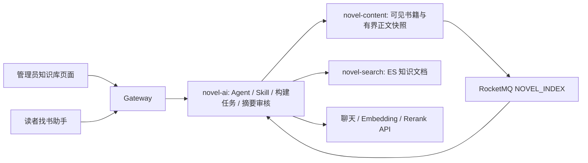

# 找书助手进阶版：正文证据、知识库与可选混合检索

## 使用

1. 重新启动 `novel-content`、`novel-search`、`novel-ai`。前端开发服务器热更新即可；使用静态部署时重新构建 admin-web 和 reader-web。
2. 管理后台 → AI 管理 → **向量模型与知识库 → 正文知识库**。搜索并勾选已上架小说，默认构建前 10 个已发布章节；每批最多 50 本，全选可分批提交，每本可选择前 1～50 章。
3. 先构建几个不同分类的作品，查看任务变成“已完成”。不勾选向量时**不调用任何模型**。
4. 读者端找书助手输入“推荐悬疑小说，想看开篇有调查线索的”。Agent 先查硬条件与详情，再用正文检索核对软偏好。卡片可展开来源和覆盖范围，默认不展示正文剧情。
5. 管理员可“查看资料 / 写摘要”：选择真实正文片段、逐字复制引文、写开篇风格摘要。保存后为待审核；审核通过且源版本有效，才进入检索工具的辅助资料。
6. “生成草稿”显式调用当前聊天模型，每次最多取 8 个开篇片段。结果仍须审核。相同小说与内容指纹的结果缓存 7 天，避免重复点击反复付费；本地 Mock 不付费。

向量配置管理新增 MySQL 表 `ai_embedding_config`，已有安装需执行 `docs/sql/embedding-config.sql`（本次已在开发虚拟机数据库执行）。密钥复用 DeepSeek 的 `AiCrypto` AES/GCM 加密，依赖同一个 `AI_KEY_SECRET`，但不修改 `ai_config`。知识材料保存在搜索服务的 ES 索引 `novel_book_knowledge_v1`，任务/摘要/策略开关保存在现有 Redis；它们需要 Redis 持久化与备份，任务记录保留 7 天、展示最近 100 条。构建不修改普通小说索引和小说原文。

## 配置 Embedding 与 Rerank

现有聊天模型配置继续用管理后台维护。聊天 API 不等于 Embedding API；不能只填写聊天模型名称就认为向量能力已经开启。

推荐在管理后台 → AI 管理 → 向量模型与知识库 → **向量接口配置**填写完整接口 URL、模型名、API Key、批量大小并保存，无需重启。输入框留空保留原密钥，明确清空才删除；读接口只返回掩码及解密异常提示。保存配置不发模型请求，调用可用性需要小批构建验证。已有环境配置在尚未保存数据库配置时仍有效；一旦保存，数据库配置优先，清空密钥后也不会回退到环境中的旧密钥。

Rerank 在 **重排模型与检索** 中配置，使用独立 MySQL 表 `ai_rerank_config`（迁移文件 `docs/sql/rerank-config.sql`，本次已初始化开发虚拟机表）。同样加密保存、掩码回显、留空保留、明确清空，保存即时生效。重排发生在读者正文查询时，无需重建知识库；成功模式带 `_RERANK`，失败降级保留原排序。环境变量仍可用于尚未保存数据库配置的部署；密钥不写进 Git。

| 环境变量 | 内容 |
| --- | --- |
| `BOOK_EMBEDDING_URL` | 完整 Embedding 接口 URL，例如供应商提供的 `/v1/embeddings` 地址 |
| `BOOK_EMBEDDING_MODEL` | Embedding 模型名称 |
| `BOOK_EMBEDDING_KEY` | 对应接口密钥 |
| `BOOK_RERANK_URL` | 完整 Rerank 接口 URL |
| `BOOK_RERANK_MODEL` | Rerank 模型名称 |
| `BOOK_RERANK_KEY` | 对应接口密钥 |

Embedding 适配器请求 `{model,input:[字符串],encoding_format:"float"}`，响应要求 `data:[{index,embedding:[数值]}]`。
Rerank 适配器请求 `{model,query,documents:[字符串],top_n}`，响应要求 `results:[{index,relevance_score}]`。供应商协议不同，需要修改适配器；并非任意聊天接口都兼容。

配置后，后台显示配置状态，但**状态不代表连通性已验证**。选择书籍并勾选“同时构建向量”，该动作会调用 Embedding；每次请求默认 8 段，可设置 1～16。内容版本与 Embedding 模型/端点标识都相同才复用索引。更换模型或端点后需重新构建向量。已构建列表目前可移除旧索引后，在待构建列表重新选择作品；仅修改密钥无需重建。

正文召回改为 ES 原生 BM25 + HNSW 近邻检索，两路前60条使用 RRF 融合，保留书籍多样性后取20条进入可选 Rerank。按书籍 ID、内容指纹和模型标识过滤，不混用旧版本。未配置向量时使用 ES BM25；失败时说明降级。候选扩展仍以已索引书籍元信息的硬条件为前置过滤（目录上限1000本），不再跨服务加载全部候选向量。显式书名/作者关键词仍走结构化搜索。原知识文档保留用于管理预览和复用；新片段索引 novel_book_chunks_v2_<维度> 保存一片段一文档。

Embedding / Rerank 请求最多 8 秒。接口失败降级并记录说明；正文检索服务失败时，仍允许基础详情推荐并明确软偏好资料不足。真正的语义效果和重排序收益，需要配置实际模型并用书库标注案例评测；本次实现不宣称已经提升某个百分比。

## 服务边界和文件



| 目录/文件 | 作用 |
| --- | --- |
| `backend/novel-common/.../internal/BookKnowledge.java` | 内部快照、片段与来源契约 |
| `backend/novel-content/.../InternalBookKnowledgeController.java` | 只提供已上架作品的已发布章节；SQL 截断超长正文 |
| `backend/novel-search/.../service/BookKnowledgeIndex.java` | 一书一 ES 文档，整本原子替换；搜索服务不引入 MySQL |
| `backend/novel-ai/.../bookfinder/knowledge/` | 构建、版本核对、排序、模型适配、待审知识摘要 |
| `backend/novel-ai/.../bookfinder/skill/BookFinderSkills.java` | 固定策略白名单与开关 |
| `backend/novel-ai/src/main/resources/agent/bookfinder/skills/` | 按偏好、相似书、换一批的任务说明 |
| `admin-web/src/components/BookKnowledgePanel.vue` | 构建、进度、资料预览、摘要审核、Skill 管理 |
| `reader-web/src/components/book-finder/RecommendationCard.vue` | 无正文摘录的来源卡片 |
| `docs/evals/book-finder/advanced-cases.json` | 30 条产品验收案例；语义案例须人工标注 |

`searchBooks.preference` 保存软偏好，`keyword` 只负责明确关键词。多轮会话会保留软偏好；“换一批”仍排除已展示书籍。模型工具为 `searchBooks`、`getBookDetails`、`searchBookEvidence`；常规最多 5 次模型轮次，最终格式异常可额外修正一次（最多6次调用），工具最多8次、60秒和默认60000个累计报告Token。修正轮禁止工具调用，最终回答阶段请求 JSON 模式；修正后仍失败返回明确格式错误。所有推荐 ID 与证据仍校验。预算可通过 `novel.ai.book-finder.max-total-tokens` 配置，它不是模型上下文窗口大小。模型工具结果省略封面地址，搜索简介最多120字。

管理端导航按模型能力分组：聊天模型与生成（接入、提示词、内容词库）；向量模型与知识库（向量接口、正文构建、风格摘要与审核）；重排模型与检索（重排接口）；运行与用量（Agent轨迹/策略、模型用量）。摘要是知识库资料，实际生成使用聊天模型。

小说导入不会自动构建正文知识库。管理员需在“找书知识库”中选择作品并构建章节索引。没有可用正文索引时，卡片明确说明正文未核实，作品只作为硬条件候选，不能声称符合成长、节奏或战力等软偏好。

条件继承仅用于明确续问，如“换一批”“只要完结”“和第二本类似”。独立的新找书问题重置分类、关键词、完结/字数、软偏好和该轮排除列表，并不向模型传入旧主题历史。先问同人、再问修仙时，不会因为没写“取消同人”而继续被限制在同人分类。

## 数据正确性与费用

- 每章最多取前 20000 字符，每书最多 100000 字符；1000 字符一片，重叠 150 字符。空章保留覆盖信息但不制造证据。达到上限明确标记截断。
- 快照指纹包含书籍元信息、章节数、章节 ID/序号/标题、章节与正文更新时间、覆盖文字。切片前后重新读取快照，版本变化时构建失败，旧任务不覆盖新内容。
- 每次正文检索与最终来源生成都复核当前数据库快照。MQ 延迟也不能让下架或已修改章节继续作为证据。
- AI 使用独立的 `group-ai-book-knowledge` 消费组，最多重试 3 次。事件只使变化的知识失效；不会自动付费重新生成摘要或向量。重复和乱序事件读取最新真值，不删除内容一致的知识。
- 管理员构建任务使用 Redis 分布式书籍锁与有界单线程队列；队列状态可查询。进程中断的任务在租约/状态期限后显示中断，可重新提交，不自动隐蔽重试模型。
- 待审摘要不能参与推荐，审核摘要也仅为辅助资料；正文仍属于不可信输入。Skill 是应用内任务说明，不能任意加载路径、执行脚本或扩大工具权限。当前提供启停与只读版本，版本升级通过代码发布。
- 模型不能伪造书 ID、跨候选查正文或引用不存在片段。正文原文只进入内部工具/管理员材料预览，不进入读者卡片、会话历史或运行日志。
- 推荐理由由服务端组装；检索命中只显示“有关联线索”，不保证整本书符合偏好。否定类要求，如“全书没有恋爱”“永远不无敌”，不能被几个片段证明。
- 同步图为 AI → search/content，search → content；没有 search → AI 的同步反向调用，也没有 content → search 的同步索引调用。
- 聊天和摘要调用沿用 AI 用量流水（找书场景）。Embedding/Rerank 为独立接口，目前记录模式、耗时、命中数、构建片段数及降级说明，**没有接入供应商计费金额统计**；费用以供应商账单为准。

## 验证与面试演示

```powershell
mvn -f backend/pom.xml -pl novel-ai,novel-content,novel-search -am package -q
node --test reader-web/tests/bookFinderSse.test.js
npm --prefix reader-web run build
npm --prefix admin-web run build
```

真实 ES 与数据库只做隔离文档/只读快照的可选测试，不调用付费模型：

```powershell
mvn -f backend/pom.xml -pl novel-content,novel-search -am test '-Dtest=BookFinderDatabaseSmokeTest,BookKnowledgeIndexSmokeTest' '-Dsurefire.failIfNoSpecifiedTests=false' '-Dbookfinder.live=true' '-Dknowledge.es.live=true'
```

演示顺序：构建几本正文 → 查看片段与覆盖范围 → 创建待审摘要并审核 → 问带软偏好的问题 → 展示工具执行状态和出处 → 换一批 → 修改或下架书验证旧知识失效 → 展示未配置/模型异常时的基础搜索降级。语义质量案例要先人工检查材料，再记录判断依据，不能只用“卡片出现了”证明推荐正确。

2026-10-13 验证：上述 Maven 打包测试、读者/管理员生产构建、4 项 SSE 解析测试通过；真实开发数据库的只读正文快照与 ES 8.13.4 的隔离知识文档往返测试通过。另执行 `python docs/tools/smoke-book-finder-advanced.py`：临时端口启动搜索/AI 服务，使用真实 ES/Redis、内存测试书籍与 Mock 模型，验证构建 → 资料预览 → 摘要待审/通过 → 正文来源推荐 → 换一批去重 → 管理员不限次数；付费调用为 0，测试知识文档、会话与任务记录已清理。没有把测试书籍导入 MySQL。真实 Embedding/Rerank 的推荐质量尚未测量。

长期偏好记忆、全书索引和大规模性能基准仍属于后续扩展。本次增强的使用方法见 [book-finder-v2.md](book-finder-v2.md)。
